# Chikita_nosql_3: граф знань MovieLens 1M у Neo4j

Завдання 3 курсу «NoSQL та векторні бази даних»: рекомендаційний граф на [MovieLens 1M](https://grouplens.org/datasets/movielens/1m/) у Neo4j з GDS і порівняння з PostgreSQL.

## Налаштування середовища

Я обрав варіант A, локальний Neo4j у Docker. AuraDB Free обмежений 200 000 вузлами і 400 000 ребрами ([документація Aura](https://neo4j.com/docs/aura/quotas-and-limits/)), тож 1 000 209 оцінок туди не влізуть. GDS там є лише в окремих сесіях Aura Graph Analytics.

```bash
curl -O https://files.grouplens.org/datasets/movielens/ml-1m.zip && unzip ml-1m.zip
python3 convert.py      # ml-1m/*.dat -> import/*.csv
docker compose up -d    # Neo4j 5.18 з APOC і GDS: http://localhost:7474, neo4j / password123
for f in part2_load part3 part4_supernodes part5_gds part6_schema; do
  docker exec -i neo4j_movielens cypher-shell -u neo4j -p password123 --format verbose < queries/$f.cypher
done
bash queries/part3_timing.sh    # час запитів частини 3
psql "$DATABASE_URL" -v ON_ERROR_STOP=1 -f queries/part6_sql_comparison.sql    # SQL для частини 6
```

Скриншоти частини 5 зроблено в Neo4j Browser запитами з `queries/part5_visualization.cypher`. Перевірено на Neo4j 5.18.1 Community, APOC 5.18.0 і GDS 2.6.9, виводи всіх скриптів лежать в `outputs/`. CSV у репозиторії немає: ліцензія GroupLens забороняє поширювати дані без дозволу. Датасет: F. Maxwell Harper, Joseph A. Konstan. The MovieLens Datasets: History and Context. ACM TiiS 5, 4, Article 19 (2015).

### Що виправлено в наданих файлах

- `docker-compose.yml` зі сторінки курсу втратив відступи YAML і частину пробілів, тож `docker compose config` його не приймав. Я відновив структуру, замінив застарілі `NEO4J_dbms_memory_heap_*` на `NEO4J_server_memory_heap_*` і виніс порти у змінні. Page cache я обмежив 512 МБ, бо інакше частина 5 падала через нестачу пам'яті.
- У `convert.py` рядки `open(...) as f_in, \\` з двома зворотними слешами давали `SyntaxError`. Тепер слеш один, а дані читаються з `ml-1m/`.

## Частина 1: схема графа

```
                                                                      (:Genre {name})
                                                                             ^
                                                                             | [:HAS_GENRE]
                                                                             |
(:User {userId, gender,  ---[:RATED {rating, timestamp}]--->  (:Movie {movieId, title, year})
        age, ageGroup,
        occupation, occupationName})
```

Та сама схема в Neo4j Browser (`CALL db.schema.visualization()`):

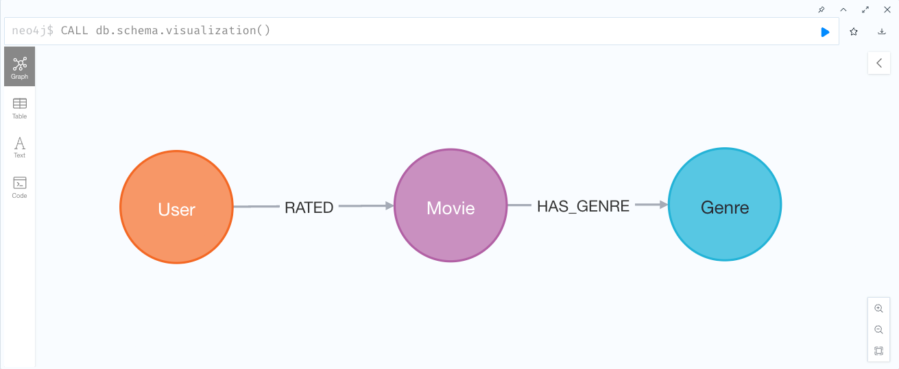

| Елемент | Кількість | Властивості |
|---|---|---|
| `User` | 6 040 | `userId` (унікальний), `gender`, `age` і `ageGroup` (код вікової групи та його розшифровка), `occupation` і `occupationName` |
| `Movie` | 3 883 | `movieId` (унікальний), `title` без року, `year` (окремо, з індексом) |
| `Genre` | 18 | `name` (унікальний) |
| `RATED` | 1 000 209 | `rating` (1-5), `timestamp` (Unix-час) |
| `HAS_GENRE` | 6 408 | немає |

**1. Що стало вузлами, а що ребрами.** Вузлами стали сутності з власною ідентичністю, з яких починаються запити: користувач, фільм і жанр. Ребра описують відношення між ними: користувач оцінив фільм (`RATED`), фільм належить жанру (`HAS_GENRE`). Демографію я лишив властивостями користувача, бо в запитах вона лише фільтр, а не точка обходу. Якби з'явилися запити «що дивляться люди тієї ж професії», професію варто було б зробити вузлом.

**2. Оцінка: ребро `RATED` чи вузол `Rating`.** Я зробив ребро з `rating` і `timestamp`. Оцінка - факт між рівно двома вузлами, власних зв'язків вона не має, і всі запити частини 3 проходять її за один крок. Мільйон ребер компактніший за мільйон вузлів `Rating` і два мільйони ребер до них, а обхід користувач-фільм-користувач удвічі коротший. Вузол мав би сенс, якби оцінка обросла власними зв'язками: рецензія з тегами, лайки, історія змін. Отже, ребро дає швидкість і простоту, а вузол розширюваність.

**3. Чому жанри окремими вузлами.** Запит «всі трилери» стартує з одного вузла `Genre` за унікальним індексом і йде по 492 ребрах. Зі списком у властивості довелося б перебрати всі 3 883 фільми. Групування за жанром (запит 4) стає групуванням за вузлом, без розгортання списків. Ціна - жанри стають супервузлами: Drama пов'язаний з 41% усіх фільмів (частина 4).

## Частина 2: завантаження

`queries/part2_load.cypher` ідемпотентний: повторний запуск не створює дублів.

1. Обмеження унікальності на `User.userId`, `Movie.movieId` і `Genre.name` (кожне створює індекс) та індекс на `Movie.year`. Я ставлю їх ще до вузлів, бо без індексу кожен `MERGE` перебирав би всі вузли з лейблом.
2. Користувачі. `LOAD CSV` читає все рядками, і без `toInteger(row.userId)` ключі `"1"` і 1 були б різними, тож `MERGE` наробив би дублів.
3. Фільми й жанри. Регулярний вираз відділяє рік з кінця назви: «Toy Story (1995)» дає «Toy Story» і 1995. Жанри розгортаються через `split` і `UNWIND` у `MERGE` вузла `Genre` і ребра `HAS_GENRE`.
4. Оцінки. Одна транзакція на 1 000 209 ребер забрала б забагато пам'яті, тож `apoc.periodic.iterate` ріже їх на батчі по 10 000. `MATCH` знаходить обидва кінці за унікальними індексами, а `MERGE` ребра захищає від дублів. `parallel: false`, бо паралельні батчі блокували б ті самі популярні фільми, аж до дедлоків.

```
batches | total   | timeTaken | committedOperations | failedOperations
101     | 1000209 | 26        | 1000209             | 0
users 6040 | movies 3883 | ratings 1000209 | genres 18 | has_genre 6408 | duplicate_pairs 0 | movies_without_year 0
```

Перевірка в кінці скрипту: кількості збігаються з README датасету, дублів пар (користувач, фільм) і фільмів без року немає.

## Частина 3: запити

Усі запити лежать у `queries/part3.cypher`. Де є сортування, стоїть другий ключ, щоб порядок не змінювався між запусками. Час у тексті - медіана п'яти прогрітих прогонів `queries/part3_timing.sh`. Browser на скриншотах показує час разом із малюванням.

### Запит 1. Трилери із середнім рейтингом понад 4.0

```cypher
MATCH (:Genre {name: 'Thriller'})<-[:HAS_GENRE]-(m:Movie)<-[r:RATED]-(:User)
WITH m, avg(r.rating) AS avg_rating, count(r) AS ratings
WHERE avg_rating > 4.0
RETURN m.title AS title, m.year AS year, round(avg_rating, 3) AS avg_rating, ratings
ORDER BY avg_rating DESC, ratings DESC, title;
```

Обхід стартує з одного вузла жанру і йде до 492 трилерів та їхніх оцінок. `WHERE` після `WITH` фільтрує вже середнє, як `HAVING` у SQL. Знайдено 52 фільми, від 43 до 2 649 оцінок у кожного (83 мс). У 8 з них 95% довірчий інтервал середнього захоплює 4.0, це рахує наступний запит у файлі.

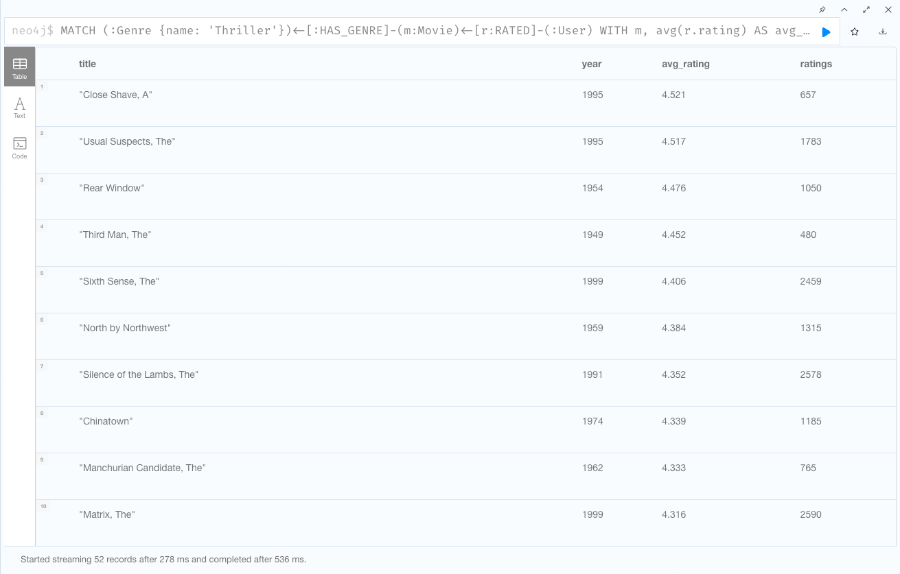

### Запит 2. Користувачі, які поставили 5 більш ніж 50 фільмам

```cypher
MATCH (u:User)-[r:RATED]->(:Movie)
WHERE r.rating = 5
WITH u, count(r) AS five_star_ratings
WHERE five_star_ratings > 50
RETURN u.userId AS userId, u.gender AS gender, u.ageGroup AS age_group,
       u.occupationName AS occupation, five_star_ratings
ORDER BY five_star_ratings DESC, userId;
```

Фільтр `r.rating = 5` відсікає ребра ще до агрегації, а умова на кількість стоїть після `WITH`. Таких користувачів 1 390 (23%). Лідер, користувач 4277, поставив 571 п'ятірку (355 мс).

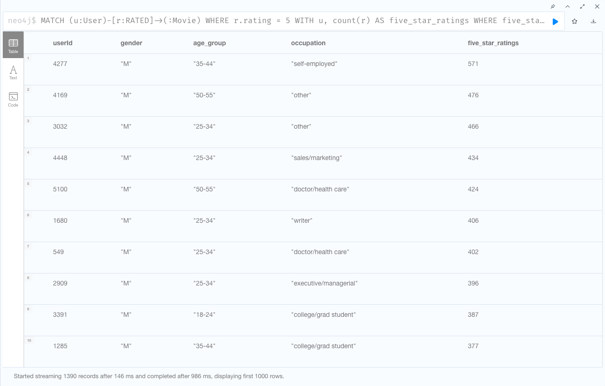

### Запит 3. Фільми, які користувачі 1 і 2 обидва оцінили на 4 або 5

```cypher
MATCH (u1:User {userId: 1})-[r1:RATED]->(m:Movie)<-[r2:RATED]-(u2:User {userId: 2})
WHERE r1.rating >= 4 AND r2.rating >= 4
RETURN m.title AS title, m.year AS year, r1.rating AS user1_rating, r2.rating AS user2_rating
ORDER BY title, year;
```

Шаблон описує фільм посередині між двома користувачами, знайденими за унікальним індексом. План розгортає їхні 53 і 129 оцінок і з'єднує їх за фільмом (`NodeHashJoin`). Спільних фільмів 7, і 6 з них обидва оцінили на 4-5 (1 мс). Рік у сортуванні потрібен, бо 38 назв належать кільком фільмам, наприклад «Sabrina» 1954 і 1995.

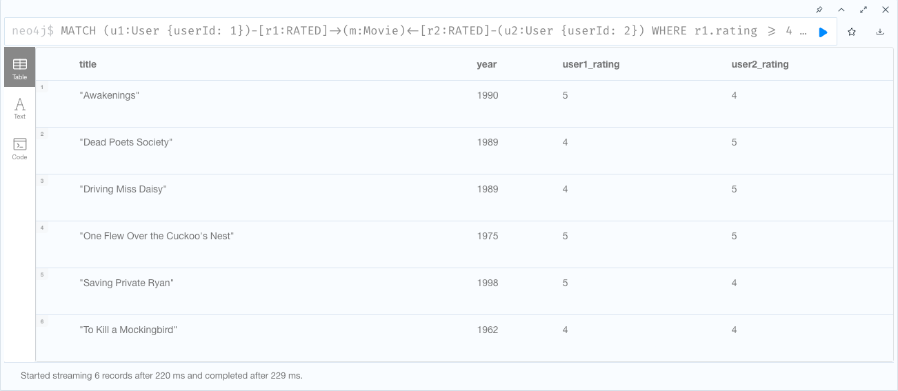

### Запит 4. Жанри, що стабільно отримують високі оцінки

```cypher
MATCH (g:Genre)<-[:HAS_GENRE]-(:Movie)<-[r:RATED]-(:User)
WITH g, avg(r.rating) AS avg_rating, count(r) AS ratings, stDev(r.rating) AS rating_stdev,
     sum(CASE WHEN r.rating >= 4 THEN 1 ELSE 0 END) AS high_ratings
RETURN g.name AS genre, round(avg_rating, 3) AS avg_rating, ratings,
       round(100.0 * high_ratings / ratings, 1) AS high_share_pct, round(rating_stdev, 3) AS rating_stdev
ORDER BY avg_rating DESC, genre;
```

«Стабільно» для мене означає ще й мало низьких оцінок, тому я додав частку оцінок 4-5 і стандартне відхилення. Film-Noir стабільний за всіма ознаками (4.075, 76.3%, 0.933), Horror навпаки (3.215, 44.6%, 1.226). Запит рахує оцінки, тож популярні фільми важать тут найбільше. Тому `part3.cypher` рахує й середні за фільмами з 20+ оцінками: лідери ті самі. Основний варіант найповільніший у частині (963 мс).

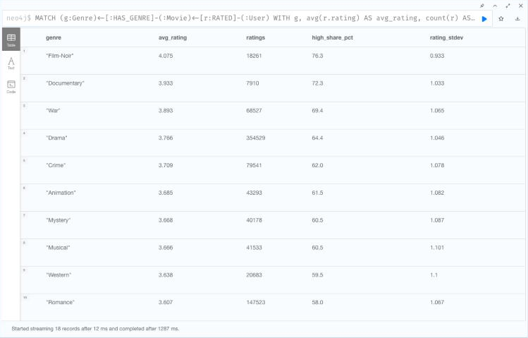

### Запит 5. «Користувачі зі схожими смаками також дивилися»

```cypher
MATCH (target:User {userId: 1})
WITH target, COUNT { (target)-[r:RATED]->() WHERE r.rating >= 4 } AS target_likes
MATCH (target)-[r1:RATED]->(m:Movie)<-[r2:RATED]-(other:User)
WHERE r1.rating >= 4 AND r2.rating >= 4
WITH target, target_likes, other, count(m) AS shared_likes
WITH target, other, shared_likes, target_likes,
     COUNT { (other)-[r:RATED]->() WHERE r.rating >= 4 } AS other_likes
WITH target, other, toFloat(shared_likes) / (target_likes + other_likes - shared_likes) AS jaccard
ORDER BY jaccard DESC, other.userId
LIMIT 25
MATCH (other)-[r:RATED]->(rec:Movie)
WHERE r.rating >= 4 AND NOT (target)-[:RATED]->(rec)
WITH rec, sum(jaccard) AS score, count(other) AS similar_users, avg(r.rating) AS their_avg_rating
RETURN rec.title AS title, rec.year AS year, round(score, 3) AS score,
       similar_users, round(their_avg_rating, 2) AS their_avg_rating
ORDER BY score DESC, similar_users DESC, title
LIMIT 10;
```

Схожість тут - індекс Жаккара за фільмами з оцінкою 4-5: спільні вподобання, поділені на всі вподобання обох. Сира кількість спільних фільмів підносила б найактивніших користувачів. Я беру 25 найсхожіших сусідів і рекомендую фільми, які вони оцінили на 4-5, а користувач 1 ще не оцінював. Бал рекомендації - сума схожостей сусідів. Вподобання користувача 1 рахуються один раз, до обходу. Він любить «Cinderella» і «Beauty and the Beast», тож першою йде «Little Mermaid» (226 мс).

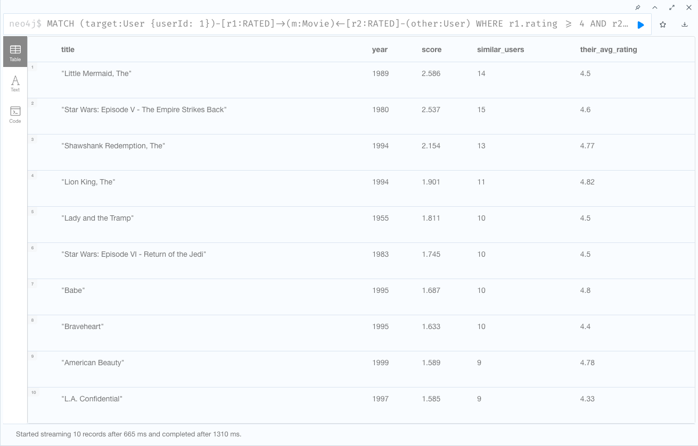

### Запит 6. Найкоротший ланцюжок між двома користувачами

```cypher
MATCH (a:User {userId: 1}), (b:User {userId: 46})
MATCH p = shortestPath((a)-[:RATED*..10]-(b))
RETURN a.userId AS from_user, b.userId AS to_user, length(p) AS path_length,
       [n IN nodes(p) | coalesce(n.title, 'User ' + toString(n.userId))] AS chain;
```

Шлях обмежений типом `RATED`, щоб не йти через `Genre`. Стрілки немає, бо від фільму до наступного користувача шлях іде проти напрямку ребра. Користувачі 1 і 2 з'єднані через «Awakenings» (довжина 2). У користувача 46 немає з користувачем 1 спільних фільмів, тож шлях довший: User 1, «Cinderella», User 536, «Wes Craven's New Nightmare», User 46 (довжина 4, 3 мс).

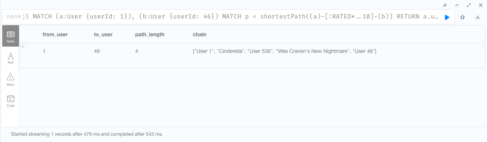

Той самий шлях графом, з оцінками на ребрах:

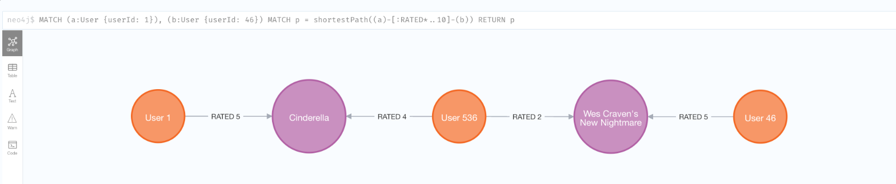

**1. Що означає довжина шляху.** Кількість ребер `RATED` у ланцюжку. Граф двочастковий, вузли чергуються (користувач, фільм, користувач), тож шлях між двома користувачами завжди парний.

**2. Довжина 2.** Обидва користувачі оцінили той самий фільм. Саме оцінили, а не вподобали: на графі вище користувач 536 поставив «Wes Craven's New Nightmare» лише 2, а `shortestPath` на значення `rating` не дивиться.

**3. Довжина 4 і 6.** Довжина 4 означає, що спільного фільму немає, але є проміжний користувач зі спільним фільмом з кожним, «друг друга» за смаком. Довжина 6 - це два проміжні користувачі, пов'язані між собою ще одним фільмом. Популярні фільми з тисячами оцінок з'єднують майже всіх, тож у MovieLens 1M найкоротший шлях майже завжди 2 або 4.

## Частина 4: супервузли

Ступінь у `queries/part4_supernodes.cypher` я рахую через `COUNT { (n)--() }`, бо `size((n)--())` у Neo4j 5 - синтаксична помилка.

**Крок 1. Пошук.** Вузли з найбільшим ступенем:

| label | node | degree |
|---|---|---|
| Movie | American Beauty | 3 430 |
| Movie | Star Wars: Episode IV - A New Hope | 2 995 |
| Movie | Star Wars: Episode V - The Empire Strikes Back | 2 995 |
| Movie | Star Wars: Episode VI - Return of the Jedi | 2 888 |
| Movie | Jurassic Park | 2 675 |

Ступінь рахує всі ребра: у American Beauty це 3 428 оцінок і 2 жанри. Межу «аномального» дає розподіл ступенів за типами вузлів:

| Ступінь | Вузлів | Середнє | Медіана | p99 | Максимум |
|---|---|---|---|---|---|
| Movie, оцінок | 3 883 | 257.6 | 109 | 1 783 | 3 428 |
| User, оцінок | 6 040 | 165.6 | 96 | 909 | 2 314 |
| Genre, фільмів | 18 | 356.0 | 211 | 1 603 | 1 603 |

**1. Які вузли виявилися супервузлами.** Насамперед популярні фільми. «American Beauty» має 3 428 оцінок, майже у 28 разів більше за медіану серед оцінених фільмів (123.5). Понад p99 (1 783 оцінки) лежать ще кілька десятків фільмів, від «Зоряних війн» до «Jurassic Park». Серед користувачів це найактивніші, до 2 314 оцінок при медіані 96. Жанри теж супервузли, але інакше. У Drama лише 1 603 ребра, проте це 41.3% усіх фільмів, а за два кроки від нього 354 529 оцінок, третина всіх.

**2. Чому запит через супервузол повільніший.** Індекс знаходить лише початковий вузол, далі Neo4j іде ланцюжком його ребер. Перехід по ребру дешевий (index-free adjacency), але щоб відібрати потрібних сусідів, треба переглянути всі. Я порівняв через PROFILE той самий запит «оцінки підлітків»:

| Запит | Ребер у вузла | Звернень до бази (DB hits) |
|---|---|---|
| American Beauty, `ageGroup = 'Under 18'` | 3 428 | 7 046 |
| Kull the Conqueror, медіанний фільм | 109 | 228 |

Обидва фільми знаходяться за індексом за 2 звернення. Далі для American Beauty план розгортає всі 3 428 ребер і читає вік кожного глядача, щоб знайти 92 підлітків. Звернень у 31 раз більше, пропорційно ступеню.

**3. Яку стратегію застосувати.** Денормалізацію агрегату. Інші стратегії з курсу я теж перевірив:

- Денормалізація агрегату. Кількість і середня оцінка лежать на вузлі фільму, тож запити 1 і 4 не розгортають оцінки: 1 047 звернень замість 571 491 і 46 551 замість 6 336 866. Ціна - оновлення агрегату при кожній новій оцінці.
- Фільтр через індекс не допоміг. Індекс на `User.ageGroup` план не змінив. З підказкою `USING INDEX` звернень 3 749, але всі 3 428 ребер фільму однаково розгортаються.
- Партиціонування за часом тут зайве, бо запити частини 3 час не фільтрують.
- Вузли-агрегатори для жанрів поки не потрібні. Драми 1995 року через жанр коштують 3 368 звернень, через індекс на рік 3 050, тож один крок через Drama недорогий. Дорогі два кроки від жанру до оцінок, і їх знімає той самий агрегат. Якби жанр виріс до мільйонів фільмів, я б розбив його за десятиліттями: `(:Genre)<-[:IN_GENRE]-(:GenreDecade {decade: 1990})<-[:IN]-(:Movie)`.

## Частина 5: алгоритми GDS (додаткова)

Частина необов'язкова, але я виконав усі три алгоритми (`queries/part5_gds.cypher`).

Запити матеріалізації з умови на повних даних падали через нестачу пам'яті. Я переписав їх з тим самим результатом: умова «понад 20 оцінок» рахується до агрегації, а пари `SIMILAR` окремо для кожного користувача. Подробиці є в коментарях `part5_gds.cypher`.

### 5.1. PageRank на графі фільмів

Ребра `CO_RATED` з'єднують фільми, які той самий користувач оцінив на 4-5, а вага - кількість таких користувачів. На картинці десять фільмів з найвищим PageRank (що темніший вузол, то вищий) і по три найміцніші ребра між ними.

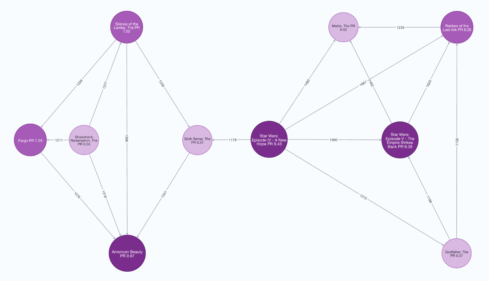

**Що означає високий PageRank.** Не просто популярність. Кореляція PageRank з кількістю оцінок 0.918, з кількістю оцінок 4-5 вже 0.982, а із середньою оцінкою лише 0.428. Тож він показує, скільки людей фільм полюбили, і додає вагу за сусідство з іншими улюбленими фільмами. «Jurassic Park» п'ятий за популярністю, але із середньою 3.76 стоїть лише 29-м. «Godfather» і «Shawshank Redemption» мають менше оцінок, проте із середньою понад 4.5 потрапили в десятку. Високий PageRank тут означає фільм-консенсус.

### 5.2. Спільноти користувачів (Louvain)

**Варіант A, як в умові.** 50 000 пар з найбільшою кількістю спільних вподобань охопили лише 1 222 найактивніших користувачі, бо сира кількість росте з активністю. Louvain знайшов 3 спільноти (765, 237 і 220 користувачів) з модульністю 0.155. Топ-3 жанри в усіх однакові (Drama, Comedy, Action), а lift не перевищує ×1.7.

**Варіант B, індекс Жаккара.** `gds.nodeSimilarity` лишає кожному користувачу 10 найсхожіших за індексом Жаккара. Граф охопив 6 038 користувачів, і Louvain знайшов 15 спільнот з модульністю 0.626. Десять найбільших:

| спільнота | користувачів | жінок | оцінок на користувача | топ-3 жанри за кількістю | характерні жанри (lift) |
|---|---|---|---|---|---|
| 5516 | 1 067 | 24.9% | 401 | Drama, Comedy, Action | Documentary ×1.55, Film-Noir ×1.30, Mystery ×1.20 |
| 5806 | 729 | 38.4% | 95 | Drama, Comedy, Thriller | Crime ×1.54, Drama ×1.39, Thriller ×1.34 |
| 2538 | 719 | 13.4% | 107 | Action, Drama, Thriller | Action ×2.00, Adventure ×1.69, Western ×1.47 |
| 1245 | 655 | 27.8% | 321 | Comedy, Drama, Action | Children's ×1.36, Animation ×1.28, Fantasy ×1.26 |
| 4697 | 575 | 28.0% | 51 | Comedy, Drama, Thriller | Animation ×1.39, Horror ×1.36, Comedy ×1.27 |
| 2605 | 493 | 32.5% | 101 | Comedy, Drama, Action | Comedy ×1.70, Romance ×1.12, Fantasy ×1.07 |
| 3169 | 490 | 25.9% | 71 | Drama, Comedy, Thriller | Film-Noir ×3.14, Documentary ×2.07, Mystery ×1.86 |
| 4943 | 459 | 15.0% | 95 | Sci-Fi, Action, Drama | Sci-Fi ×2.97, Fantasy ×1.98, Adventure ×1.58 |
| 2148 | 324 | 27.8% | 37 | Drama, Comedy, Action | Horror ×1.33, Thriller ×1.20, Mystery ×1.18 |
| 3748 | 235 | 64.7% | 72 | Comedy, Romance, Drama | Romance ×3.10, Comedy ×1.77, Animation ×1.08 |

Lift - частка жанру в оцінках 4-5 спільноти, поділена на його частку серед усіх оцінок 4-5. Частина розбиття йде за активністю: найактивніша 5516 і найменш активні 4697 і 2148 мають слабкий жанровий профіль.

На картинці по 20 найзв'язніших користувачів романтичної 3748 (червоні), фантастичної 4943 (сині) і нуарової 3169 (сірі) спільнот, біля номера стать. Жодне з 208 ребер між ними не веде в іншу спільноту.

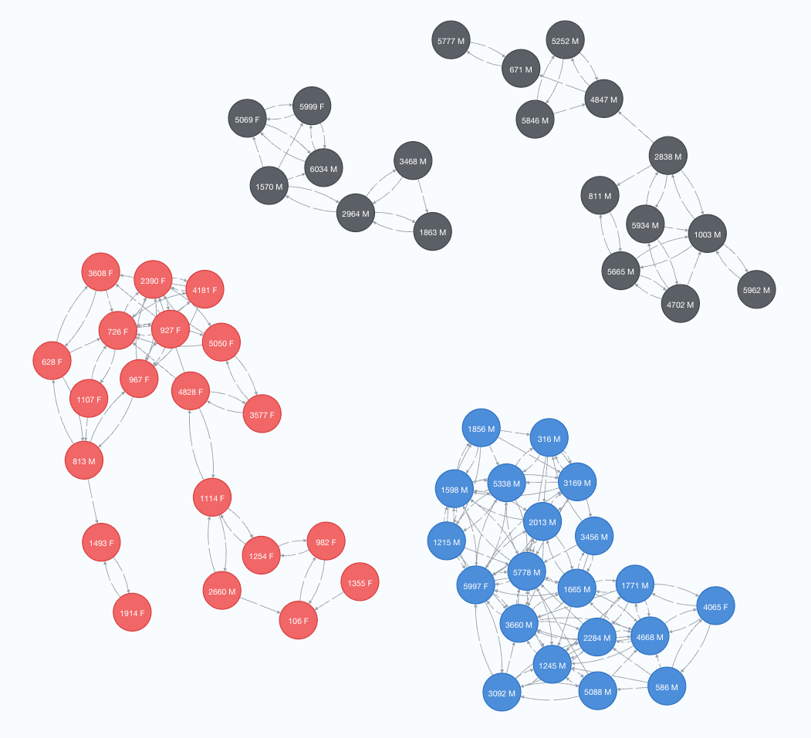

**1. Чи відповідають кластери інтуїтивним групам.** У варіанті B так. Є «любителі бойовиків» (Action ×2.0), «фанати фантастики» (Sci-Fi ×2.97), «цінителі нуару й документалістики» (Film-Noir ×3.14), сімейне кіно, кримінальні драми, романтичні комедії. Любителі жахів утворили окрему невелику спільноту 4007 (106 користувачів, Horror ×9.45). У варіанті A таких груп немає.

**2. Як я це перевірив.** Ознаками, яких алгоритм не бачив. Спільноти будувалися лише зі схожості оцінок, а жанровий профіль вийшов чітким. Те саме зі статтю: серед усіх користувачів 28.3% жінок, у «романтичній» спільноті 64.7%, у «бойовиках» 13.4%, у «фантастиці» 15.0%. Випадкові кластери дали б рівномірний розподіл.

### 5.3. Найкоротший шлях між користувачами

Вага `SIMILAR` - це схожість, а Дейкстра мінімізує суму ваг, тому кроки я рахую без ваги. Пари взято з графа: три найменш пов'язані користувачі (19, 23, 42) і найбільш пов'язаний (4277). У варіанті A всі шляхи йдуть через 4277: у нього 1 198 сусідів із 1 222, тож граф з умови вийшов зіркою.

| Пара | Варіант A | Варіант B |
|---|---|---|
| 19 - 23 | 2 кроки, через 4277 | 3 кроки: 19, 462, 1230, 23 |
| 19 - 42 | 2 кроки, через 4277 | 3 кроки: 19, 712, 2599, 42 |
| 23 - 42 | 2 кроки, через 4277 | 2 кроки: 23, 949, 42 |
| 19 - 4277 | 1 крок | 4 кроки: 19, 533, 710, 549, 4277 |

На картинці шлях 19 - 4277 з варіанта B, у дужках кількість оцінок. Кожен наступний користувач активніший за попереднього, від 255 до 1 743 оцінок. Індекс Жаккара не перевищує відношення меншої множини вподобань до більшої, тож між 19 і 4277 він не більший за 0.10. А в десятку найсхожіших користувача 19 потрапляють лише сусіди від 0.219, тому шлях піднімається сходинками активності.

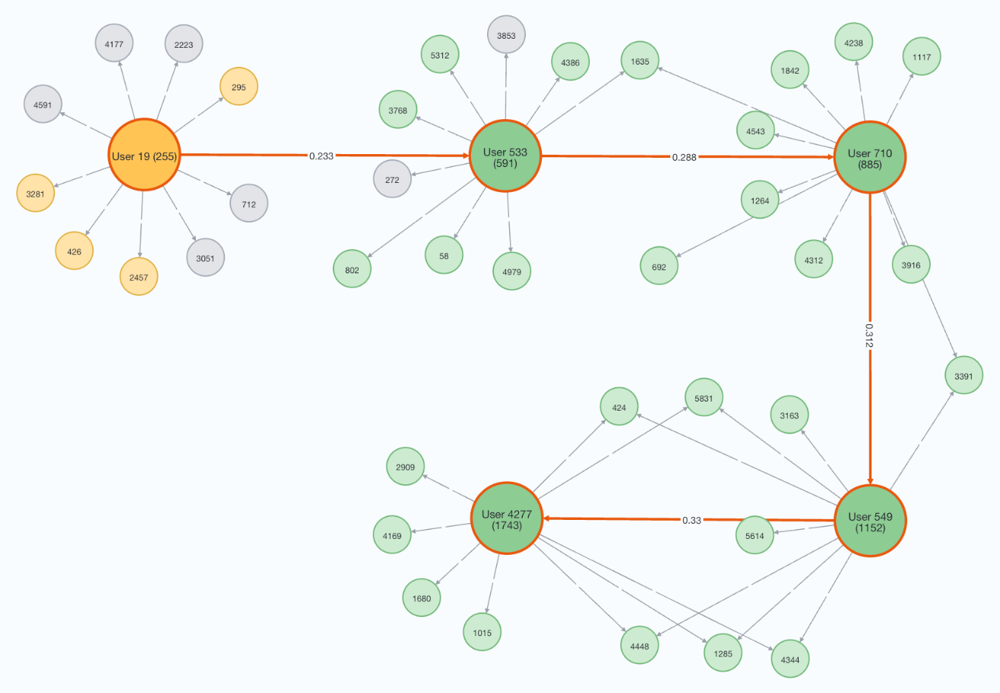

**1. Наскільки тісний світ у цьому датасеті.** Дуже тісний. У графі оцінок двох користувачів майже завжди з'єднує спільний фільм або один проміжний глядач. У графі схожості в користувача в середньому 16.9 сусіда, і все одно між двома користувачами в середньому лише три проміжні.

**2. Середня довжина шляху і «шість рукостискань».** У варіанті B я порахував 120 740 найкоротших шляхів від 20 користувачів: у середньому 4.0 кроку, максимум 7, довших за 6 лише 34. Гіпотеза підтверджується. Середні 1.94 кроку у варіанті A - артефакт супервузла: без користувача 4277 граф ділиться на 144 компоненти, і 143 користувачі (12%) лишаються відрізаними.

## Частина 6: аналіз і висновки

Ті самі CSV я завантажив у PostgreSQL 16 з індексами на ключі, `ratings(movie_id)` і `movie_genres` (`queries/part6_sql_comparison.sql`). Результати збігаються з Neo4j до третього знака. Час - медіана п'яти прогрітих прогонів на тій самій машині (`part3_timing.sh` і повтори в psql).

| Запит | Neo4j | PostgreSQL 16 |
|---|---|---|
| 4: агрегація за жанрами по всіх оцінках | 963 мс | 153 мс |
| 1: трилери із середнім понад 4.0 | 83 мс | 61 мс |
| 6: найкоротший ланцюжок користувач 1 - користувач 46 | 3 мс | 1 486 мс |

**1. Граф проти SQL.** Найважче в SQL запит 6. Найкоротший шлях невідомої довжини потребує рекурсивного CTE, який хвилями обходить двочастковий граф:

```sql
WITH RECURSIVE wave(kind, id, depth) AS (
    SELECT 'user', 1, 0
  UNION
    SELECT CASE WHEN w.kind = 'user' THEN 'movie' ELSE 'user' END,
           CASE WHEN w.kind = 'user' THEN r.movie_id ELSE r.user_id END,
           w.depth + 1
    FROM wave w
    JOIN ratings r ON (w.kind = 'user' AND r.user_id = w.id)
                   OR (w.kind = 'movie' AND r.movie_id = w.id)
    WHERE w.depth < 4
)
SELECT min(depth) AS path_length FROM wave WHERE kind = 'user' AND id = 46;
```

Глибину тут треба обмежити вручну. `UNION` не пам'ятає відвіданих вузлів, тож хвилі розростаються до 5 900 і 6 040 користувачів, майже до всіх. PostgreSQL рахує хвилі до кінця, бо не знає, що ціль уже знайдено: 1.5 с проти 3 мс. `shortestPath`, за документацією Neo4j, шукає з обох кінців і зупиняється, щойно хвилі зустрілися. Запит 5 у SQL можливий через три-чотири самоз'єднання `ratings` на мільйон рядків, і кожен крок «друга друга» додає ще одне. У Cypher це просто довший шаблон.

**2. Де граф програє.** На агрегаціях по всьому датасету. Запит 4 у Neo4j проходить кожне ребро оцінки поодинці (6.3 млн звернень). PostgreSQL читає таблицю послідовно в трьох паралельних процесах і робить хеш-з'єднання з хеш-агрегацією: 153 мс проти 963 мс. На запиті 1 різниця менша, 61 мс проти 83 мс, бо Neo4j проходить лише оцінки трилерів. Реляційна модель краща для звітів на кшталт «середня оцінка за жанрами й роками», вивантаження в CSV, аналітики по всіх користувачах і довільних фільтрів за кількома колонками. Супервузли їй не заважають: популярний фільм - це просто більше рядків.

**3. Покращення схеми.** Зміни для чотирьох запитів я виміряв через PROFILE (`queries/part6_schema.cypher`, агрегати в `part4_supernodes.cypher`). Результати ті самі, крім частки 4-5 і розкиду в запиті 4 та рекомендацій в останньому рядку.

| Запит | Зміна схеми | Звернень до бази до | після |
|---|---|---|---|
| 1 (трилери) | `ratingCount` і `avgRating` на вузлі `Movie` | 571 491 | 1 047 |
| 4 (жанри) | ті самі агрегати на `Movie` | 6 336 866 | 46 551 |
| 3 (спільні вподобання двох користувачів) | окреме ребро `LIKED` для оцінок 4-5 | 419 | 173 |
| 5 (рекомендації) | ребро `LIKED` | 2 234 530 | 168 300 |
| 5 (рекомендації) | передобчислені ребра `SIMILAR_JACCARD`, 10 сусідів | 2 234 530 | 28 356 |

- Агрегати на `Movie` описані в частині 4. На вузлі `Genre` вони дали б запиту 4 лише 18 вузлів.
- Ребро `LIKED` (575 281 ребро) дає обхід за типом, без читання `rating`. У запиті 5 `COUNT { (other)-[:LIKED]->() }` береться зі збереженого лічильника ступеня, а з `RATED` доводилося переглядати всі оцінки кандидата. Звернень у 13 разів менше, топ-5 рекомендацій той самий. Ціна - друге ребро для 58% оцінок.
- Передобчислена схожість зводить рекомендацію до двох кроків, і звернень майже у 80 разів менше. Сусідів 10, а не 25, тож у топ-5 лишилися самі мультфільми, як «Sleeping Beauty» і «Pinocchio». Ребра схожості можна перераховувати раз на добу.
